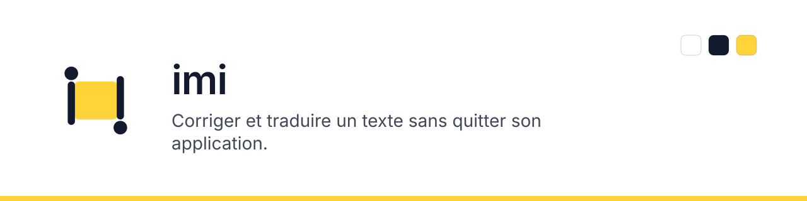

<!-- carte:en-tete:debut — fabriqué depuis projet.yml par sophos/outils/carte.mjs ; ne pas modifier à la main -->
# Graker Local

<picture>
  <source media="(prefers-color-scheme: dark)" srcset=".github/carte/banniere-sombre.svg">
  
</picture>

**État** actif · **Sorte** application macOS personnelle
<!-- carte:en-tete:fin -->

## Ce que c'est

### Origine et objectif

Ce projet vient d'une demande d'Antoine : reproduire l'outil présenté sur
[graker.fehey.com](https://graker.fehey.com/) pour son usage personnel sur Mac,
en appliquant les méthodes [Sophos](https://antoineberjoan.github.io/sophos/).
L'objectif est de corriger et traduire un texte depuis l'application où il écrit,
avec un raccourci, une explication et la possibilité de remplacer la sélection.
La copie sert ensuite de base pour adapter l'outil à nos propres cas d'usage.

L'interface est en français. Les fournisseurs proposés sont Google Gemini et
un service compatible OpenAI. Le fournisseur DeepSeek et les langues d'interface
chinoises de Graker ne sont pas repris.

Le périmètre accepté dans le chat est une application native SwiftUI, avec
AppKit et les API macOS pour les fonctions système, et les clés API personnelles
de l'utilisateur. Tailwind n'est pas utilisé pour l'interface. Le fichier CSS
de design sert uniquement de source aux tokens Swift générés. « Local » décrit
l'application installée sur le Mac ; les traitements IA utilisent l'API choisie.

### Fonctionnement et limites

Un outil personnel natif, inspiré du fonctionnement public de Graker 1.6.3 :
correction expliquée, traduction, affinage et panneau près de la sélection.
SwiftUI dessine l'interface. Les adaptateurs macOS utilisent AppKit, Accessibilité
et Carbon pour les fonctions système. Aucun service intermédiaire.

Les requêtes partent directement vers le fournisseur choisi. Ce n'est pas un
modèle hors ligne. Les clés vont dans le trousseau ; les préférences locales
n'en contiennent aucune. Les dix résultats récents restent dans la mémoire du
processus et disparaissent à sa fermeture.

Les sources publiques ne donnent ni le code de Graker ni tous ses comportements.
Ce projet est une réimplémentation personnelle, sans affiliation avec son auteur.
La fidélité visuelle et les intégrations doivent être vérifiées sur un Mac.
Le remplacement porte sur du texte ; la conservation intégrale d'un courriel
HTML, de ses images et de ses styles n'est pas garantie.

## Démarrer

Mac sous macOS 15 ou plus, Xcode 16 ou plus, Python 3 et Node.js pour les
vérifications et les fichiers générés. Aucune dépendance Swift externe.

Le workflow GitHub produit aussi `Graker-Local-macOS.zip`, contenant une `.app`
signée localement (ad hoc). Le runner actuel utilise Apple Silicon ; cette
archive vise donc les Mac Apple Silicon. Sur Intel, le script ci-dessous
construit l'application pour le Mac qui l'exécute.

```sh
python3 Scripts/check-foundation.py
swift test
bash Scripts/build-app.sh
open "dist/Graker Local.app"
```

Ouvrir aussi `Package.swift` dans Xcode pour développer. Pour l'usage quotidien,
lancer le paquet `.app` construit, qui garde un identifiant stable pour le
trousseau et les permissions. Une signature ad hoc locale ne vaut ni signature
Developer ID ni notarisation ; une reconstruction peut demander de réautoriser
l'application dans les réglages macOS.

Choisir le fournisseur et le modèle dans Réglages → Fournisseur IA. Le bouton
« Valider et enregistrer » envoie une requête de test au fournisseur affiché.
Les frais éventuels sont ceux de son API. L'application ne demande pas de clé
dans le chat et ne dispose d'aucune clé partagée.

La correction de la sélection utilise ⇧⌘G ; la traduction utilise ⇧⌘T.
Les raccourcis sont modifiables et suivent la disposition du clavier. Dans le
panneau, ⌘Retour lance le traitement ; Retour garde la saisie sur plusieurs lignes.
Le bouton « Coller et corriger/traduire » colle et lance ; un collage ordinaire
dans la saisie ne lance pas de requête à lui seul. Les actions sur une sélection demandent
l'autorisation Accessibilité de macOS. La saisie manuelle fonctionne sans elle.
Le remplacement refuse une sélection qui a changé ; Copier reste disponible.

Pour régénérer les tokens : `python3 Scripts/generate-tokens.py`.
Pour la carte, utiliser le script central de Sophos épinglé dans AGENTS.md :
`node ../sophos/outils/carte.mjs --verifier`. Il ne se copie pas dans le projet.

### Archive et reprise dans une autre session

L'archive de sources contient le code Swift de l'application, les tests, les
règles et les décisions. Elle ne contient ni la transcription intégrale du chat,
ni une application `.app` compilée, ni de clé API. Le présent README et les
décisions conservent l'objectif et les choix nécessaires à une reprise.

Pour produire une archive avec l'historique Git, depuis un dépôt sans changement
non enregistré :

```sh
python3 Scripts/export-project.py
```

Le fichier `dist/Graker-Local-sources.zip` contient aussi `history.bundle`, une
sauvegarde de toutes les références Git locales, et `EXPORT.txt`, qui identifie
le commit exporté. La session de revue peut restaurer le dépôt complet après
extraction, depuis un autre dossier :

```sh
git clone --branch main /chemin/vers/graker-local/history.bundle graker-local-review
cd graker-local-review
git log --oneline
```

La branche à restaurer est écrite dans `EXPORT.txt` : utiliser cette valeur
si l'archive provient de la branche d'import plutôt que de `main`.

Avant la revue, lire `AGENTS.md`, ce README, la décision de fondation et le
contrat réseau. Le contrôle Python et les tests du noyau sont exécutables sous
Linux. Sur Mac, lancer le script de construction, puis le parcours manuel décrit
ci-dessous. Le workflow macOS compile l'application, exécute les tests et
produit l'archive `.app`. Les essais interactifs restent distincts de ces
contrôles automatiques.

## Organisation du dépôt

```text
Design/                              source unique des tokens et icônes vectorielles
Sources/GrakerCore/                   types, contrats, requêtes, SSE, révisions, placement
Sources/GrakerLocal/                  point d'entrée de l'application
Sources/GrakerLocal/Platform/         réseau, trousseau, sélection, raccourcis, fenêtres
Sources/GrakerLocal/Presentation/     vues SwiftUI, état observable et tokens générés
Tests/GrakerCoreTests/                contrats et cas limites du noyau
Scripts/                             génération, contrôles et construction de l'app
Documentation/Decisions/              décisions datées et contrats
.github/carte/                       bannières produites par le script central Sophos
.github/workflows/                   compilation, tests macOS et archive de l'application
```

Cette carte fixe les emplacements ; un dossier ne naît qu'avec son premier fichier.
Le noyau ne dépend pas de l'application. Les adaptateurs importent le noyau.
L'état observable orchestre les adaptateurs ; les vues lisent cet état et des rôles
de tokens. Le fichier Swift de tokens est généré, jamais maintenu à la main.
Les règles de noms vivent dans AGENTS.md ; les contrats et critères dans la décision.
Le [contrat réseau](Documentation/Network.md) cite les exemples officiels des API.

## Liens avec les autres projets

<!-- carte:liens:debut — fabriqué depuis projet.yml par sophos/outils/carte.mjs ; ne pas modifier à la main -->
- **Applique** : [sophos](https://github.com/antoineberjoan/sophos)
<!-- carte:liens:fin -->

Le dépôt choisi est [antoineberjoan/uchi](https://github.com/antoineberjoan/uchi).
Son nom GitHub est conservé ; le produit intégré s'appelle Graker Local.
Les sources, images et workflows du précédent Scratch (Tauri/React) sont
remplacés par le projet Swift. Sa branche de sauvegarde est supprimée à la
demande de l'utilisateur. L'historique Git existant n'est pas réécrit.
Les cinq commits du projet Graker préparé localement sont également conservés
comme ascendance de l'import. La suppression des fichiers n'efface donc pas
l'ancien projet de l'historique Git.

La PR de `feat/graker-local` porte le remplacement. Après sa fusion, une autre
session peut repartir de `main` et lire ces documents. L'utilisateur autorise
la publication dans le dépôt public fourni ; sa visibilité ne change pas.
Référence fonctionnelle : [Graker](https://graker.fehey.com/)
et son [journal](https://graker.fehey.com/changelog), consultés le 7 novembre 2026.

## Règles et décisions

[AGENTS.md](AGENTS.md) active les méthodes Sophos sans les recopier.
[Décision de fondation](Documentation/Decisions/2026-11-07-foundation.md) : options,
critères de qualité, couches, tokens et contrats.
[Décision d'import dans uchi](Documentation/Decisions/2026-11-07-repository.md) :
raison du remplacement et conservation des deux historiques.
[Décision de publication](Documentation/Decisions/2026-11-07-publication.md) :
publication dans uchi et suppression de la branche de sauvegarde.
[Décision de fiabilité](Documentation/Decisions/2026-11-08-reliability.md) :
lecture du flux SSE, blancs de la sélection et retour du focus.
[Décision des fournisseurs](Documentation/Decisions/2026-11-08-providers.md) :
retrait de DeepSeek et absence de texte chinois.

Le noyau compile sous Linux avec Swift 6.0.3 ; ses 34 tests XCTest passent.
L'application complète compile aussi sur macOS 15 Apple Silicon : les 34 tests,
la construction release et la vérification de signature passent dans
[GitHub Actions](https://github.com/antoineberjoan/uchi/actions/runs/42428268030).
La vérification Python contrôle la fondation, la génération et les frontières.
Les essais interactifs de permissions, raccourcis, placement multi-écrans et
remplacement restent à effectuer sur un Mac. La compilation ne prouve pas ces
comportements. Aucun appel à un fournisseur réel n'a été validé avec une clé API.

Le rendu natif conserve les sauts de ligne et les styles Markdown en ligne.
Les titres, tableaux et blocs complexes restent lisibles sous forme de texte
Markdown ; leur rendu complet de Graker n'est pas encore reproduit.

Le parcours manuel minimal est : régler un fournisseur → saisir une phrase →
corriger → affiner → traduire → copier ; puis sélectionner dans TextEdit et dans
un navigateur → lancer le raccourci → remplacer ; enfin changer la sélection
avant de remplacer, révoquer la permission, annuler une requête et simuler un
fournisseur inaccessible. Chaque échec doit rester visible, sans perdre la saisie.

## Licence

Usage personnel demandé. Aucune licence de redistribution n'est accordée ici.
Les éléments de marque et captures de Graker ne sont pas inclus. Les méthodes
Sophos sont seulement référencées ; leur licence et leurs restrictions restent
dans leur dépôt d'origine.
